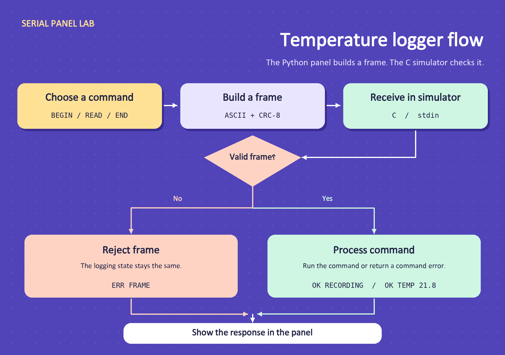

# Serial Panel Lab

A Python desktop panel and a C simulator for a temperature logger. Start a recording, request a simulated temperature reading, or send a deliberately corrupt frame to see the receiving process reject it.

## Call flow documentation

[English article](docs/en/README.md) · [مقالهٔ فارسی](docs/fa/README.md)

[Interactive workflow (English)](docs/en/workflow.md) · [گردش کار تعاملی (فارسی)](docs/fa/workflow.md)



## Build and try it

Use Python 3 and a C99 compiler on Linux. The desktop panel also needs Tkinter and a running graphical session. On Debian-based distributions the Tkinter package is typically named `python3-tk`.

```sh
mkdir -p build
cc -std=c99 -Wall -Wextra -Werror -pedantic simulator/temperature_node.c -o build/temperature-node
python3 panel.py --demo
python3 panel.py
python3 -m unittest discover -s tests -v
```

The Python process sends newline-delimited commands to the C process over standard input and reads one response per request from standard output. Each command carries a two-digit CRC-8 (polynomial 0x07, initial value 0) computed over its ASCII command text. `BEGIN` starts recording, `READ` asks for the next synthetic sample, and `END` stops recording.

The demo needs no physical sensor or serial adapter. It is designed for Linux desktops and Linux single-board computers with a compatible compiler and Python installation. Raspberry Pi and Orange Pi hardware have yet to be tested.
