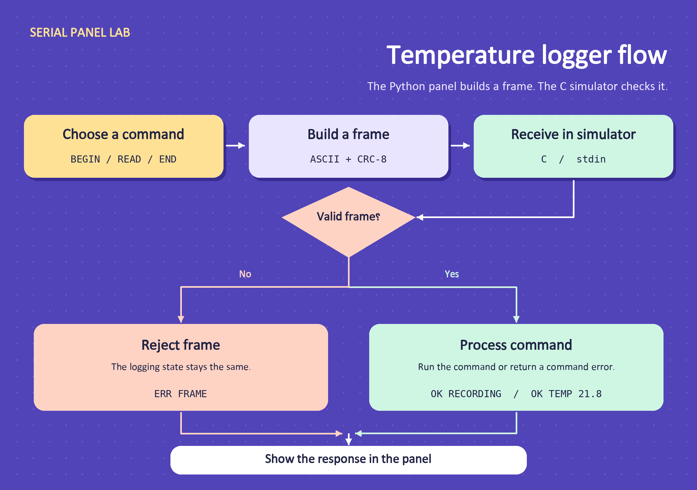
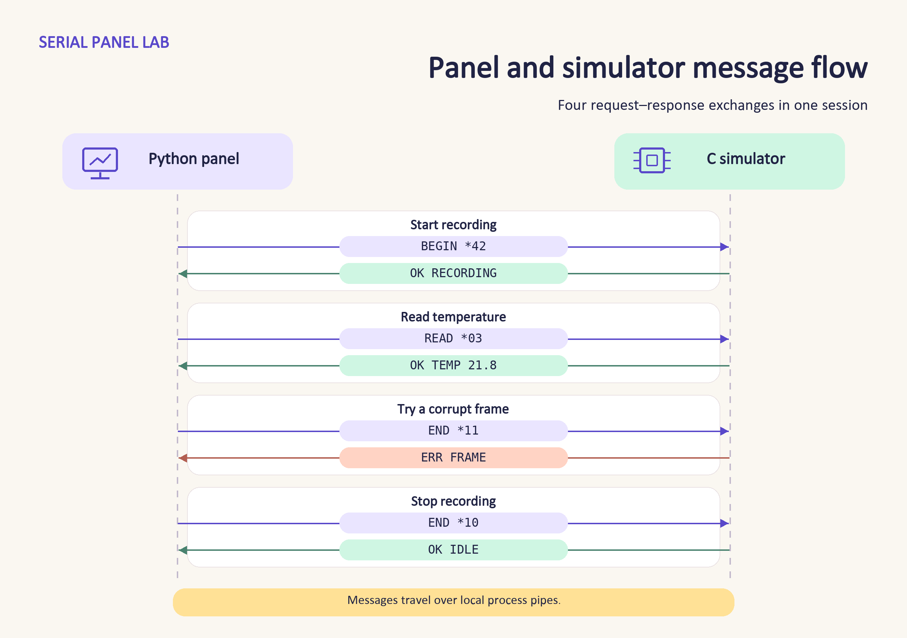
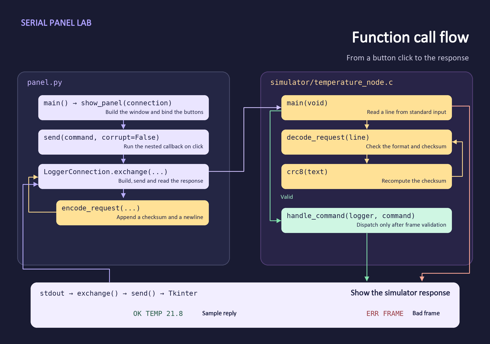
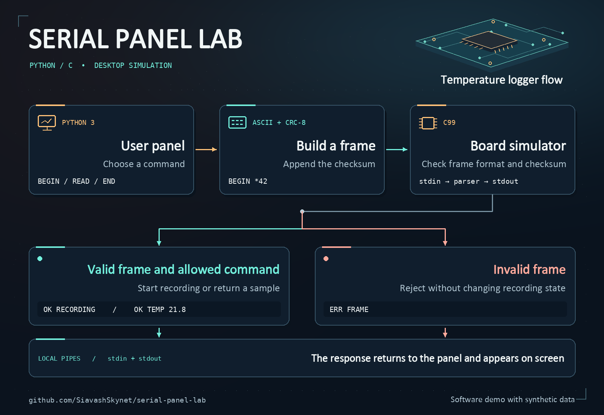

# Serial Panel Lab call flow

[فارسی](../fa/README.md) · [Project and build instructions](../../README.md)

Serial Panel Lab lets you test a desktop temperature logger before connecting any hardware. A Python panel sends a command to a C simulator and displays the response. The demo uses local process pipes and synthetic temperatures.

ScreenSteps describes three ways to document a procedure. We use a **flowchart** to show the decision at a glance, a **standard article** to reproduce the demo, and an **interactive workflow** to guide readers according to the response they get. The message and function diagrams are supporting views of the same procedure. [ScreenSteps article](https://blog.screensteps.com/best-call-flow-software)

## 1. Flowchart

The simulator checks each newline-delimited request before applying it. A malformed frame returns `ERR FRAME` and leaves the recording state alone. A valid frame reaches the command handler. A valid `READ` can still return `ERR IDLE` if recording has stopped.

## 2. Standard article

1. Build the simulator using the [project instructions](../../README.md). Run `python3 panel.py --demo` for the automated example, or `python3 panel.py` in a graphical session.
2. In a fresh session, click **Start**. The panel sends `BEGIN *42` and the simulator replies `OK RECORDING`.
3. Click **Read**. The first synthetic reading is `OK TEMP 21.8`.
4. Click **Send bad frame**. This sends an intentionally corrupt stop command, `END *11`. Expect `ERR FRAME`. Click **Read** again to check that recording continues.
5. Click **Stop**. The valid stop frame is `END *10`; the reply is `OK IDLE`. Reading again returns `ERR IDLE`.

The diagram below shows four exchanges from that session. Each request has an ASCII command, a space, an asterisk, two hexadecimal CRC-8 digits and a newline. Each response is one text line.

### Function calls

A button calls `send()` inside `show_panel()`. It calls `LoggerConnection.exchange()`, which uses `encode_request()` before writing the request. On the C side, `main()` assembles the input line and calls `decode_request()`. The decoder uses `crc8()` to check the checksum when the format is valid. If decoding succeeds, `main()` calls `handle_command()`. Otherwise, it emits `ERR FRAME`. On return, `send()` updates the reply text and, for successful replies, the applicable temperature or state field. [Python source](../../panel.py) · [C source](../../simulator/temperature_node.c)

## 3. Interactive workflow

Start with **Read**, then click the result you received. Each choice takes you to the relevant next step. The guide works through GitHub links.

[Start the interactive workflow](workflow.md)
