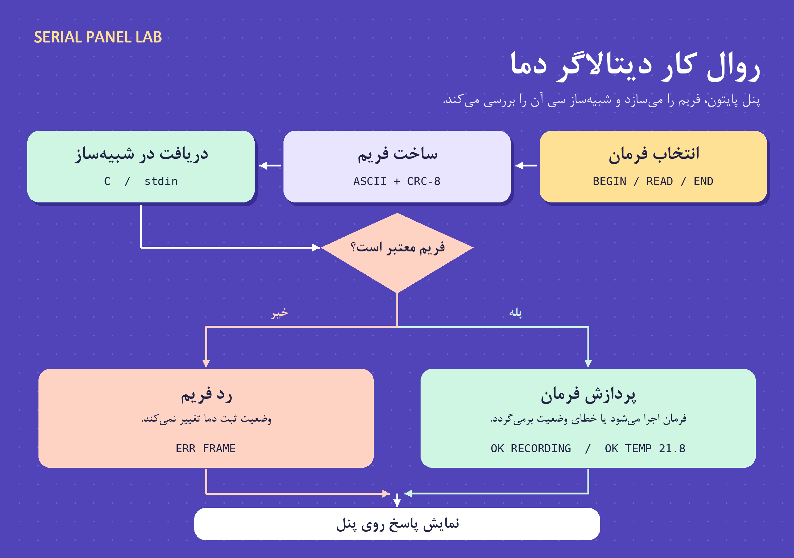
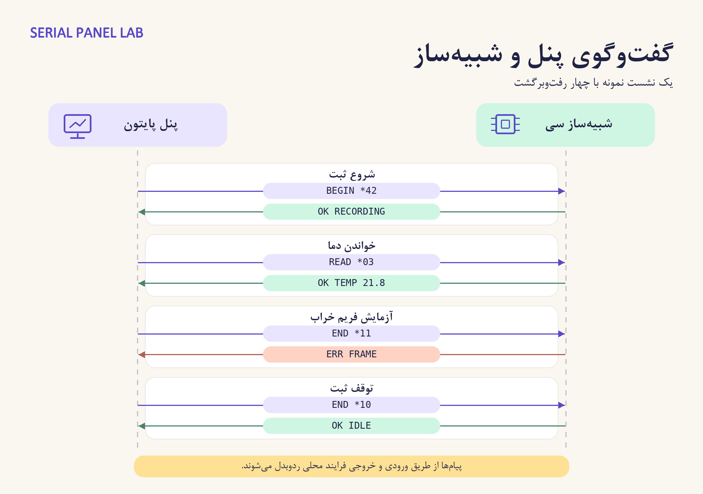
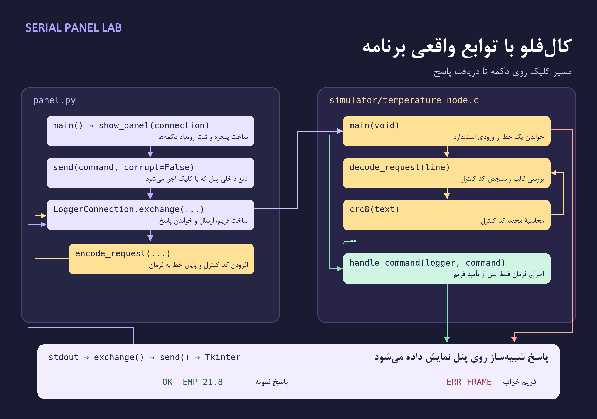
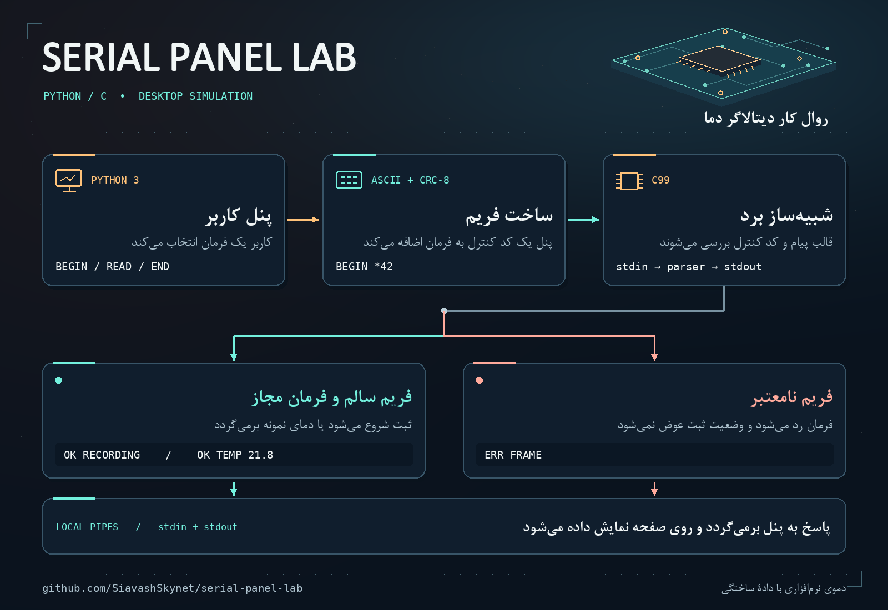

# کال‌فلوی Serial Panel Lab

[English](../en/README.md) · [پروژه و دستور ساخت](../../README.md)

در این دمو می‌توان رفتار یک دیتالاگر دما را پیش از وصل کردن سخت‌افزار بررسی کرد. پنل پایتون به شبیه‌ساز سی فرمان می‌فرستد و پاسخ را نمایش می‌دهد. پیام‌ها از مسیر ورودی و خروجی استاندارد فرایند محلی عبور می‌کنند و دماها ساختگی‌اند.

ScreenSteps سه قالب برای مستندسازی یک روال معرفی می‌کند. در این پروژه **فلوچارت** تصمیم اصلی را در یک نگاه نشان می‌دهد، **مقالهٔ استاندارد** مراحل اجرای دمو را توضیح می‌دهد و **گردش کار تعاملی** بر اساس پاسخی که دیده‌ای، قدم بعد را مشخص می‌کند. نماهای پیام و توابع هم جزئیات همین روال را نشان می‌دهند. [مقالهٔ ScreenSteps](https://blog.screensteps.com/best-call-flow-software)

## ۱. فلوچارت

شبیه‌ساز هر درخواست را قبل از اجرای فرمان بررسی می‌کند. فریم نامعتبر پاسخ `ERR FRAME` می‌گیرد و وضعیت ثبت دست‌نخورده می‌ماند. فریم معتبر به تابع اجرای فرمان می‌رسد. حتی با فریم معتبر هم اگر ثبت فعال نباشد، فرمان `READ` پاسخ `ERR IDLE` می‌گیرد.

## ۲. مقالهٔ استاندارد

۱. شبیه‌ساز را طبق [دستور ساخت پروژه](../../README.md) بساز. برای نمونهٔ خودکار `python3 panel.py --demo` و برای پنجره در محیط گرافیکی `python3 panel.py` را اجرا کن.  
۲. در یک نشست تازه، **Start** را بزن. پنل `BEGIN *42` را می‌فرستد و شبیه‌ساز `OK RECORDING` برمی‌گرداند.  
۳. **Read** را بزن. اولین نمونهٔ ساختگی دما `OK TEMP 21.8` است.  
۴. **Send bad frame** را بزن. پنل عمداً فرمان توقف خراب `END *11` را می‌فرستد و `ERR FRAME` می‌گیرد. با **Read** دوباره بررسی کن که ثبت ادامه دارد.  
۵. **Stop** را بزن. فرمان درست `END *10` است و پاسخ `OK IDLE` می‌گیرد. **Read** بعد از توقف، `ERR IDLE` برمی‌گرداند.

تصویر چهار رفت‌وبرگشت همین نشست را نشان می‌دهد. هر درخواست از فرمان ASCII، فاصله، ستاره، دو رقم هگزادسیمال CRC-8 و پایان خط تشکیل می‌شود. پاسخ هم یک خط متن است.

### مسیر فراخوانی توابع

کلیک روی دکمه، `send()` را داخل `show_panel()` اجرا می‌کند. این تابع به `LoggerConnection.exchange()` می‌رسد و `encode_request()` فریم را برای ارسال آماده می‌کند. سمت سی، `main()` خط ورودی را جمع می‌کند و به `decode_request()` می‌دهد. اگر قالب درست باشد، تابع رمزگشا با `crc8()` کد کنترل را بررسی می‌کند. `main()` پس از تأیید فریم، `handle_command()` را اجرا می‌کند و در غیر این صورت `ERR FRAME` می‌فرستد. در مسیر برگشت، `send()` متن پاسخ و در صورت موفقیت، دما یا وضعیت ثبت را به‌روزرسانی می‌کند. [سورس پایتون](../../panel.py) · [سورس سی](../../simulator/temperature_node.c)

## ۳. گردش کار تعاملی

روی **Read** بزن و پاسخی را که گرفته‌ای انتخاب کن. هر انتخاب تو را به قدم مرتبط می‌برد. راهنما با لینک‌های خود گیت‌هاب کار می‌کند.

[شروع گردش کار تعاملی](workflow.md)
